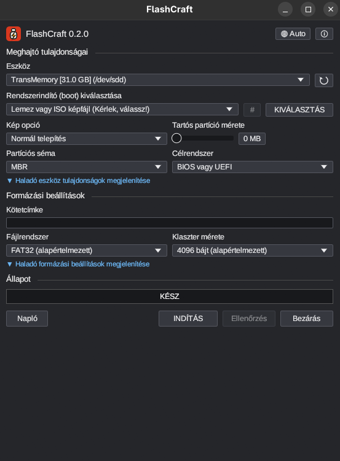

<p align="center">
  
</p>

<h1 align="center">FlashCraft</h1>

<p align="center">
  <b>Bootable USB media; an open-source, clean-room reimplementation of Rufus, rebuilt in pure Rust.</b><br>
  Pick an image, pick a drive, write, verify. Native app, no Electron, no web view.
</p>

<p align="center">
  
  
  
</p>

<p align="center">
  
</p>

<table>
  <tr>
    <td width="33%" valign="top">
      <h3>Refuses the wrong drive</h3>
      Only removable, unmounted devices can be written — checked structurally, not by a warning you can click through.
    </td>
    <td width="33%" valign="top">
      <h3>Native and small</h3>
      Native egui on desktop, the same code compiles to WebAssembly. No Electron, no web view.
    </td>
    <td width="33%" valign="top">
      <h3>Agent-ready</h3>
      Every action is a command (<code>drives.list</code>, <code>media.write</code>, <code>media.verify</code>), so the UI, the CLI and scripts share one engine.
    </td>
  </tr>
</table>

## Features

- Enumerates removable drives from sysfs: size, vendor, model, mount state.
- Writes ISO 9660 / MBR / GPT images in 4 MiB streamed chunks with live
  **Writing → Verifying → Syncing** progress, cancel, throughput and elapsed time.
- Byte-for-byte read-back verification and automatic unmount before writes;
  elevation through `pkexec`/polkit — never a setuid binary.
- ISO 9660 volume-label patching so the label you type lands on the media.
- Compressed images streamed on the fly: `.xz`, `.gz`, `.zst`, `.bz2`, `.zip`.
- MD5 / SHA-1 / SHA-256 checksums computed on the fly, copyable to clipboard.
- Non-bootable formatting: MBR/GPT partition schemes with FAT32, NTFS, exFAT,
  UDF, ext4, ext3 or ext2 — cluster-size selection, quick format, extended
  label + `autorun.inf`.
- Persistent `ext4` partition sizing, 1–4-pass bad-block scan, old-BIOS fixes,
  runtime UEFI media validation.
- 38-language UI (translations reused from Rufus' GPLv3 catalog).

## Downloads

Get the installers from the [Releases page](https://github.com/dorit33/flashcraft/releases)
(`dist/` is built locally by the scripts in `packaging/`):

| File | What it is |
|---|---|
| `flashcraft-<ver>-1.*.x86_64.rpm` | Fedora, openSUSE, RHEL: `sudo dnf install ./flashcraft-…rpm` |
| `flashcraft-<ver>-linux-x86_64.deb` | Debian, Ubuntu, Mint, Pop!_OS: `sudo apt install ./flashcraft-…deb` |
| `flashcraft-<ver>-linux-x86_64.AppImage` | Runs on almost any distro: `chmod +x` and run |
| `flashcraft-<ver>-linux-x86_64.tar.gz` | Plain tree (`bin/`, `share/`) for everyone else |
| `flashcraft-<ver>-x86_64.flatpak` | Flatpak bundle (`flatpak install`) |
| `flashcraft-<ver>-windows-{x64,x86}.msi`, `-windows-x64-portable.zip` | Windows builds — the UI runs; drive backend is Linux-only for now |
| `flashcraft-web-<ver>.zip` | WebAssembly build of the same UI |
| `flashcraft-<ver>.zip`, `SHA256SUMS.txt` | Source archive + checksums |

Linux binaries are built against **GLIBC_2.35** in a container, so they run on
Pop!_OS 22.04+, Debian 12+, Fedora and anything newer.

## Get started

You need a recent stable Rust (1.85 or newer). On Linux, install the windowing headers first
(Debian/Ubuntu: `sudo apt install libxkbcommon-dev libwayland-dev libx11-dev libxrandr-dev libxi-dev libgl1-mesa-dev`;
Fedora: `sudo dnf install libxkbcommon-devel wayland-devel libX11-devel libXrandr-devel libXi-devel mesa-libGL-devel`).

```sh
cargo run -p flashcraft-cli -- list                         # what can I write to?
cargo run -p flashcraft-cli -- inspect fedora.iso         # what kind of image is it?
sudo ./target/debug/flashcraft-cli write fedora.iso /dev/sdb --yes
sudo ./target/debug/flashcraft-cli verify fedora.iso /dev/sdb
cargo run --release -p flashcraft                         # the desktop app
cargo xtask ci                                            # fmt, clippy, tests, layers, wasm
```

Block-device writes need root; the supported grant is a polkit prompt (`pkexec`) or `sudo`.

## Status

v0.2.0. On Linux the full path works end to end: enumerate, inspect, write, verify,
sync, format, checksums. The Windows packages cross-build and the app opens, but
`flashcraft-native` enumerates drives through Linux sysfs/polkit only — a real
Windows backend is roadmap work. Flatpak runs sandboxed without raw block-device
access; host udisks2 integration is planned. See `ROADMAP.md` and `docs/gaps.md`.

## License

GPL-3.0-only. The UI translations are reused from Rufus' `res/loc/rufus.loc`
(GPLv3, © Pete Batard and the Rufus translators) — sharing the license is what
makes that reuse legal.
